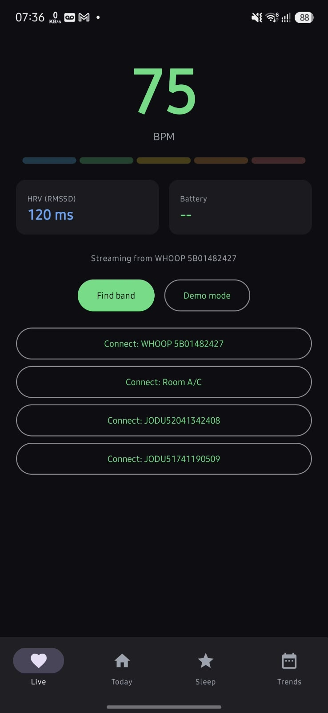
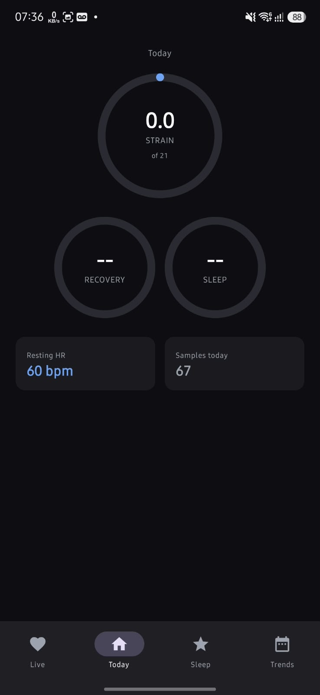
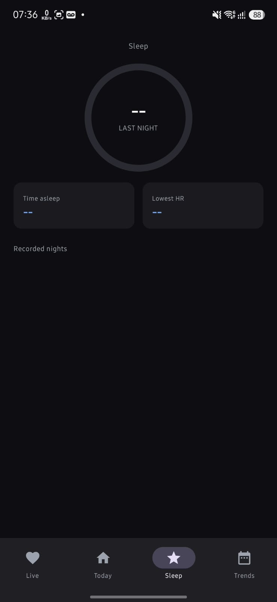
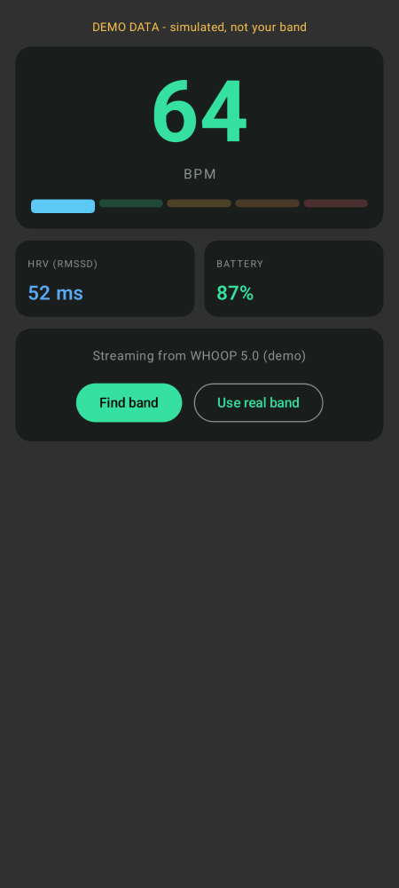
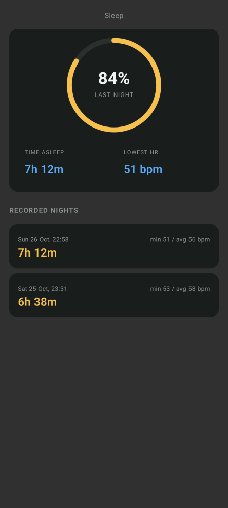
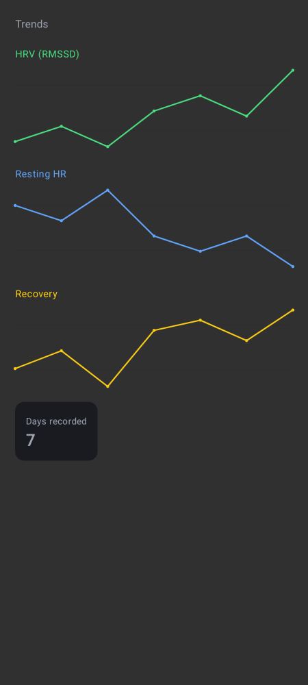

# Shoop

An offline-first Android companion for your WHOOP band (or any Bluetooth heart-rate band).
Live heart rate and HRV, local strain / recovery / sleep scores, and on-device history -
no account, no cloud, no internet permission.

Shoop is written from scratch in Kotlin with Jetpack Compose (Material 3).

## Screenshots

Real device: Shoop v1.0.0 streaming from a WHOOP 5.0 (Galaxy A35, 26 Oct 2026):

| Live (streaming) | Today | Sleep |
|---|---|---|
|  |  |  |

UI renders of the app's own code through Android's layoutlib (Paparazzi), demo data:

| Live | Today | Sleep | Trends |
|---|---|---|---|
|  |  |  |  |

## Features

- **Live heart rate over BLE** - connects to any band broadcasting the standard
  Bluetooth Heart Rate Service (0x180D / 0x2A37). On WHOOP, enable
  *HR Broadcast* in the official WHOOP app first.
- **Real HRV** - beat-to-beat RR intervals from the band, rolling RMSSD computed on-device.
- **Local scores** - strain (0-21), recovery (0-100, green/yellow/red), and sleep score,
  all computed on your phone from your own recorded data. Formulas are original and
  documented in [docs/SCORING.md](docs/SCORING.md).
- **Battery level** from the standard Battery Service (0x2A19).
- **History on-device** - recordings and daily summaries stored as local files/DataStore.
  Nothing leaves the phone: the APK requests **no INTERNET permission**.
- **Demo mode** - a clearly-labelled simulated heart-rate source that exercises the same
  parsing, HRV, scoring and UI pipeline as a real band, so the app can be tried and
  tested without hardware.
- **Dark, glanceable UI** - Jetpack Compose, Material 3.

## Privacy

Offline by design. No analytics, no ads, no accounts, no servers. The only permissions
are Bluetooth (and location on Android 11 and below, which Android requires for BLE
scanning - Shoop never reads your location).

## Build

Requirements: JDK 17, Android SDK (platform 35, build-tools 35.0.0).

```bash
./gradlew :app:assembleDebug        # debug APK -> app/build/outputs/apk/debug/
./gradlew :app:testDebugUnitTest    # unit tests (parser, HRV, scoring)
./gradlew :app:recordPaparazziDebug # regenerate the screenshots in docs/screenshots/
```

A prebuilt debug APK is attached to the latest
[release](https://github.com/nekxxy/shoop/releases).

## Changelog

- **1.0.1** (26 Oct 2026): fix battery read on real bands - GATT operations are now
  serialized (battery is read after the notification descriptor write completes, not
  concurrently); bands without the standard Battery Service show "N/A" instead of "--".
- **1.0.0** (26 Oct 2026): first release.

## Install

1. Download the APK from Releases onto your phone.
2. Allow "install from unknown sources" when Android asks.
3. In the official WHOOP app, turn on HR Broadcast (Strap Settings).
4. Open Shoop, grant Bluetooth permission, tap **Find band**, pick your band.

## Testing status - verified vs untested

**Verified on real hardware (WHOOP 5.0, "WHOOP 5B01482427", Galaxy A35, 26 Oct 2026):**
- Scan, connect and service discovery against the physical band.
- Live heart-rate streaming (75 BPM on capture) and RR-interval-based RMSSD (120 ms
  on capture) through the standard Heart Rate Service with HR Broadcast enabled.

**Verified in this repo's CI-style local run:**
- Compiles clean (AGP 8.7.3, Kotlin 2.0.21, compileSdk 35, minSdk 26).
- 19 unit tests pass: BLE Heart Rate Measurement byte parsing (all flag combinations),
  RMSSD math against hand-computed values, outlier rejection, strain/recovery/sleep/zone
  score bounds and monotonicity.
- All four screens render correctly (screenshots above), exercised end-to-end through
  the real parsing/scoring pipeline using the demo source.

**Not yet verified:**
- Sleep, recovery and strain scores against real overnight/all-day band data - the
  formulas are unit-tested, but no real night has been recorded yet.
- Battery level on WHOOP 5.0: v1.0.1 fixes a GATT serialization bug that dropped the
  battery read; if the 5.0 does not expose the standard Battery Service over its
  broadcast profile, Shoop shows "N/A" instead of a number.
- Sleep detection currently scores recordings you capture overnight; automatic
  sleep-stage detection (deep/REM) is not claimed.
- Background recording (screen off) is not in v1; keep the app open while recording.

## License

MIT - see [LICENSE](LICENSE).
